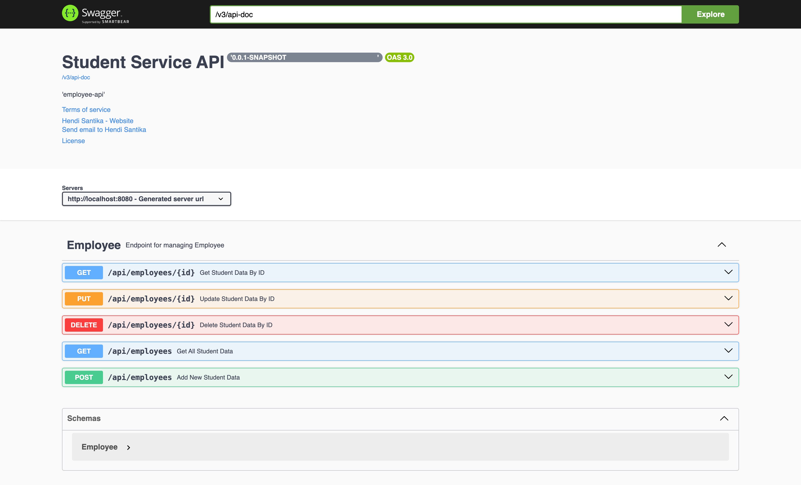

# employee-api

[](https://github.com/hendisantika/employee-api/actions/workflows/maven.yml)


[](.github/dependabot.yml)

This is the Backend (REST API) Repository for the Front End UI.
Check this Front End Repository --> https://github.com/hendisantika/react-front-end.git

## Tech Stack

- Java 25 (Temurin)
- Spring Boot 4 (Web MVC, Data JPA, Docker Compose support, DevTools)
- MySQL 26.7
- springdoc-openapi (Swagger UI)
- Lombok
- Testcontainers + JUnit 5
- Maven Wrapper

## Prerequisites

- JDK 25
- Docker (used by Spring Boot Docker Compose support & Testcontainers)

## Things todo list

1. Clone this repository: `git clone https://github.com/hendisantika/employee-api.git`
2. Navigate to the folder: `cd employee-api`
3. Run the application: `./mvnw clean spring-boot:run`
   (MySQL is started automatically from `compose.yaml` via Spring Boot Docker Compose support)
4. Open Your favorite browser: http://localhost:8080/swagger-ui

## API Endpoints

Base path: `/api/employees`

| Method   | Endpoint              | Description           |
|----------|-----------------------|-----------------------|
| `POST`   | `/api/employees`      | Create a new employee |
| `GET`    | `/api/employees`      | Get all employees     |
| `GET`    | `/api/employees/{id}` | Get employee by ID    |
| `PUT`    | `/api/employees/{id}` | Update employee by ID |
| `DELETE` | `/api/employees/{id}` | Delete employee by ID |

OpenAPI docs are available at http://localhost:8080/v3/api-doc

## Build & Test

```shell
./mvnw clean verify
```

Integration tests use [Testcontainers](https://testcontainers.com/) (MySQL), so Docker must be running.

## CI/CD & Dependency Updates

- **GitHub Actions** ([`maven.yml`](.github/workflows/maven.yml)) builds and tests the project on JDK 25 for every push and
  pull request to `main`. Testcontainers Cloud is used when the `TC_CLOUD_TOKEN` secret is available; otherwise the
  runner's local Docker is used (e.g. for Dependabot PRs). On push to `main`, the Maven dependency graph is submitted to
  GitHub.
- **Dependabot** ([`dependabot.yml`](.github/dependabot.yml)) checks Maven, GitHub Actions and Docker Compose images
  daily, with grouped updates (Spring Boot, springdoc, testing, minor/patch) and conventional commit messages.

## Swagger UI


